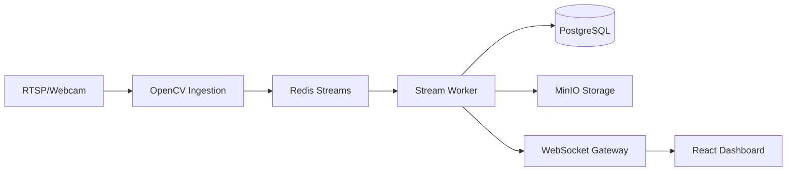

# Distributed Real-Time Video Analytics Pipeline

## 🚀 Overview
A high-performance, distributed video analytics engine designed for real-time Edge AI processing. This system ingests multi-modal video streams, processes them using a deep learning pipeline (ONNX/PyTorch), and delivers real-time analytical metadata via WebSockets to a React-based monitoring dashboard.

## 🏗️ Architecture


## 🛠️ Key Technical Highlights
- **Sub-50ms Inference**: Optimized ONNX Runtime with CUDA acceleration.
- **Distributed Ingestion**: Scalable worker queues via Redis/Celery.
- **Low-Latency UI**: WebSocket broadcasting to Canvas overlays.
- **Production-Ready**: Containerized microservices, Prometheus metrics, and automated migration management.

## 🚀 Quickstart
1. **Prerequisites**: Install [Docker Desktop](https://www.docker.com/products/docker-desktop/) (with WSL2 if on Windows).
2. **Setup**:
   ```bash
   make setup-dev
   ```
3. **Run Pipeline**:
   ```bash
   make up
   make migrate-apply
   ```
4. **Access**:
   - Dashboard: `http://localhost:3001`
   - API Docs: `http://localhost:8000/docs`
   - Metrics: `http://localhost:9090`

## 📊 API & WebSocket Specs
| Route | Method | Description |
| :--- | :--- | :--- |
| `/api/v1/stream/ws` | WS | Real-time telemetry/metadata stream |
| `/api/v1/cameras` | GET/POST | Manage camera sources |
| `/api/v1/events` | GET | Retrieve analytical event history |

🤖 Generated with [Claude Code](https://claude.com/claude-code)
